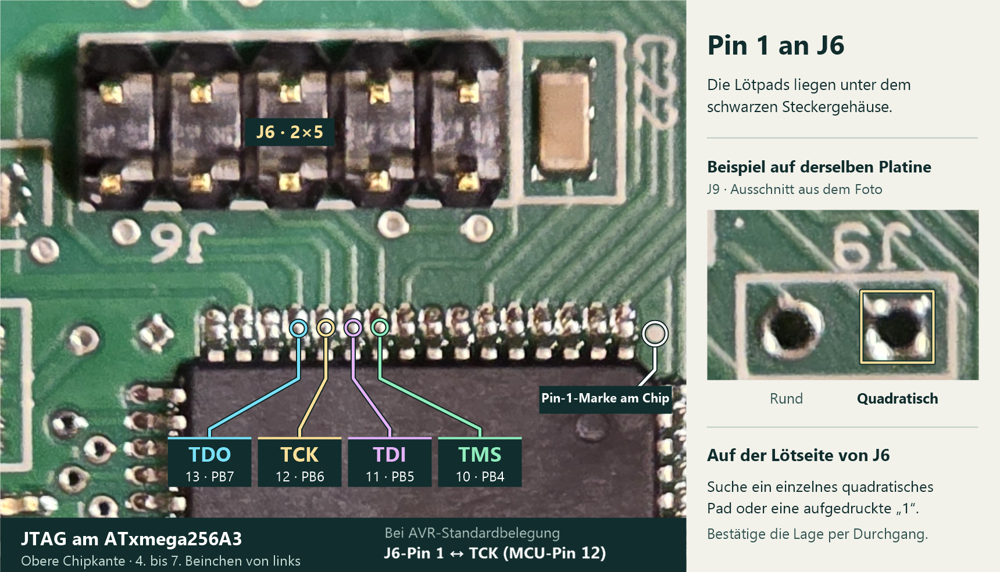

# Braumeister controller board

## ATxmega256A3 JTAG pins and header J6

The four colored rings mark consecutive leads on the edge of the microcontroller facing J6. Count from the left in the photo. The white dot at the right end of this row identifies the microcontroller’s pin 1 corner. [ATxmega256A3 datasheet, Table 30-2](https://ww1.microchip.com/downloads/en/DeviceDoc/Atmel-8068-8-and16-bit-AVR-XMEGA-A3-Microcontrollers_Datasheet.pdf#page=51)

| Lead from the left | ATxmega pin | JTAG signal | J6 contact if wired to the AVR standard |
|---|---|---|---|
| 4th | 13 (PB7) | TDO | 3 |
| 5th | 12 (PB6) | TCK | 1 |
| 6th | 11 (PB5) | TDI | 9 |
| 7th | 10 (PB4) | TMS | 5 |

J6’s housing covers its solder pads in this view. On the solder side, look for a pin 1 marking or a single square pad like the one visible at J9. A continuity check on the unpowered board can establish whether all four J6 contacts match the table. [Microchip AVR JTAG header pinout](https://onlinedocs.microchip.com/oxy/GUID-DDB0017E-84E3-4E77-AAE9-7AC4290E5E8B-en-US-4/GUID-27BF3A3E-B61E-485F-8816-EBB7F5642827.html)

## Battery-backed clock and external EEPROM

A separate close-up of the component side shows an eight-pin device marked `79412I` next to C35, the cylindrical crystal, and the CR2032 holder. The marking identifies a Microchip MCP79412. This chip combines a real-time clock, 128 bytes of general-purpose EEPROM, and an eight-byte protected EEPROM block that ships with a factory-programmed EUI-64 identifier. [Microchip MCP79412 datasheet, device selection and package markings](https://ww1.microchip.com/downloads/aemDocuments/documents/MPD/ProductDocuments/DataSheets/MCP79410-MCP79411-MCP79412-Battery-Backed-I2C-RTCC-DS20002266.pdf)

The firmware requests eight bytes starting at offset `0xF0` from the 7-bit I²C address `0x57`. Those offsets, `0xF0` through `0xF7`, match the protected identifier block. Its other request at `0x6F`, starting at offset `0x00`, matches the clock registers. The board photo identifies the device. The eight identifier bytes on this unit remain unknown. [Microchip MCP79412 memory map, Figure 5-1](https://ww1.microchip.com/downloads/aemDocuments/documents/MPD/ProductDocuments/DataSheets/MCP79410-MCP79411-MCP79412-Battery-Backed-I2C-RTCC-DS20002266.pdf) · [BrewControl TWIE requests and tested bus responses](../results/ADCA-TWIE-STARTUP-RESULTS.md)
